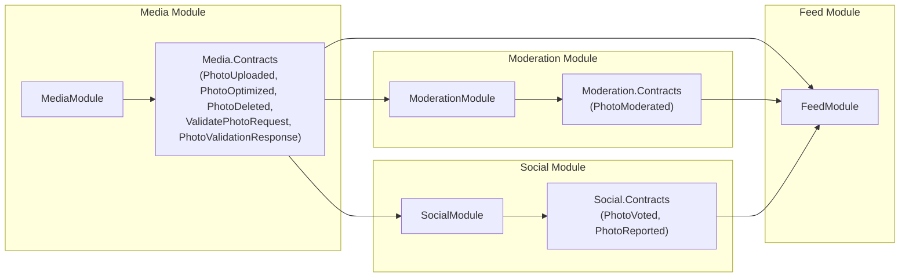
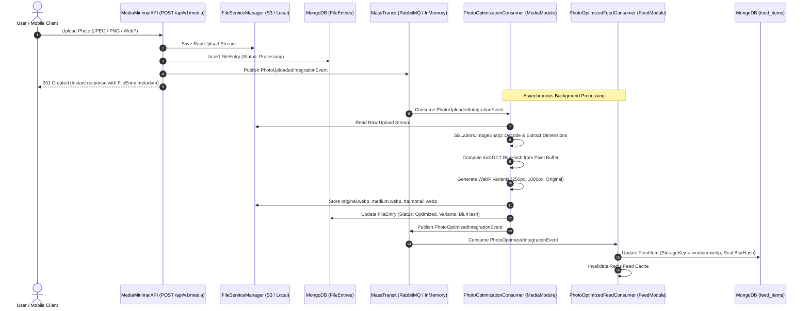
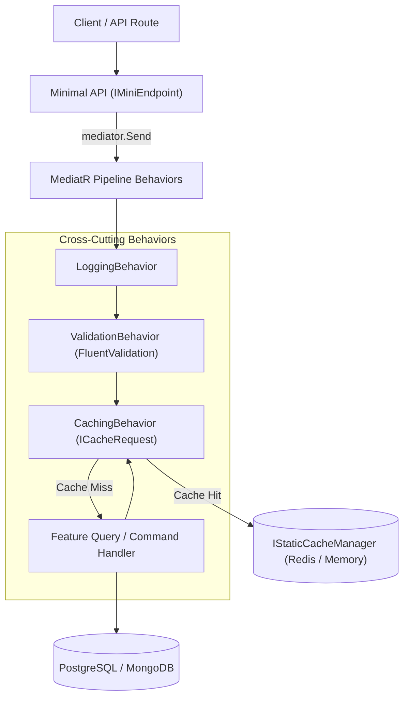
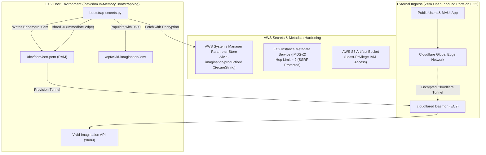

# Vivid Imagination — .NET Modular Monolith Reference Architecture

**Presentation Topic:** *From MVP to Scale: A Modular Monolith Approach to .NET Development*

**Vivid Imagination** is a visual photo-sharing and community application engineered as an enterprise-grade **.NET 10 Modular Monolith**. It demonstrates how to evolve from a fast MVP into a scalable, event-driven, production-ready system with:
- 📱 **Cross-Platform .NET MAUI 10 Mobile Client (Android & Windows)** with interactive Blur Shield reveal
- 🤖 **Autonomous AI Moderation via Amazon Rekognition (`AWSSDK.Rekognition`)**
- 🛡️ **Unsafe Tagging & UI Blur Shield (`BlurRequired = true`, `BlurHash`, `SensitiveContentWarning`)**
- 🖼️ **Asynchronous Background WebP Transcoding & Responsive Resizing (Thumbnail: 256px, Medium: 1080px, Original) + Pixel-Accurate 4x3 DCT BlurHash**
- 🗑️ **Cascading Storage Pruning across S3/Local upon Photo Deletion**
- 💾 **Polyglot Persistence (PostgreSQL + MongoDB with optimized compound and sparse indexes + Redis)**
- 🔑 **Startup Role Seeding & Strict Runtime Verification (`IdentityContextSeed`, Snowflake IDs, `ROLE_NOT_CONFIGURED`)**
- 📨 **Autonomous Modular Messaging (`IMessagingModule` + MassTransit + RabbitMQ)**
- 🔄 **Synchronous Cross-Module Validation via MassTransit RPC (`IRequestClient<ValidatePhotoRequest>`)**
- 📦 **Decentralized Module Contracts (`*.Contracts` isolation)**
- ⚡ **Vertical Slice CQRS Minimal APIs (`IMiniEndpoint` + MediatR + FluentValidation)**
- 🚀 **Pipeline Caching & Tag Invalidation (`ICacheRequest`, `IInvalidateCacheRequest`, `IStaticCacheManager`)**
- 🔒 **Hardened Zero-Trust Cloud Deployment (Zero-open-port EC2 via Cloudflare Tunnel, AWS SSM Parameter Store `SecureString` secrets, ephemeral in-RAM certificate provisioning with immediate shredding)**
- 📐 **Compile-Time Architecture Boundary Enforcement (`NetArchTest`)**
- 🔄 **GitHub Actions Multi-Job CI/CD (Backend Testing, Android Mobile Build, GHCR Docker Build, EC2 Deployment)**

---

## Documentation Suite

- 📋 **[Product & Software Requirements Specification (SRS)](docs/REQUIREMENTS.md)**
- 🏗️ **[Modular Monolith Scope & Architecture Case Study](docs/ARCHITECTURE_SCOPE.md)**
- 🚀 **[AWS EC2 & Cloudflare Deployment Guide](docs/DEPLOYMENT_GUIDE.md)**

---

## Architecture & Module Breakdown

Each business capability is encapsulated into its own autonomous module folder containing an **Implementation Project** and an isolated **Public Contracts Project (`*.Contracts`)**:

| Module | Responsibility | Public Contracts | API Pattern | Storage Engine | Schema / Collection |
| :--- | :--- | :--- | :--- | :--- | :--- |
| **`IdentityModule`** | OAuth2/OIDC authentication, JWT tokens, user safety preferences | `Identity.Contracts` | Minimal API (`MapIdentityApiV1`) | **PostgreSQL** (`EF Core`) | `identity.*` |
| **`MediaModule`** | S3 photo uploads, background WebP transcoding (3 variants), pixel BlurHash, cascading cleanup, entity validation | `Media.Contracts` | Minimal API (`MapMediaApiV1`) | **MongoDB** (`MongoDB.Driver`) + **AWS S3** | `FileEntries` |
| **`ModerationModule`** | **Amazon Rekognition** AI vision scan, 3-tier safety policy, audit trail, moderator override, photo validation | `Moderation.Contracts` | Minimal API (`MapModerationApiV1`) | **MongoDB** (`MongoDB.Driver`) | `moderation_reviews` |
| **`SocialModule`** | Upvotes/downvotes, vote cancellation, 2-flag community content reporting, photo validation | `Social.Contracts` | Minimal API (`MapSocialApiV1`) | **PostgreSQL** (`EF Core`) | `social.*` |
| **`FeedModule`** | Denormalized feed read-models, dynamic score ranking, personalized stream, UI blur flags | `Feed.Contracts` | Minimal API (`MapFeedApiV1`) | **MongoDB** + **Redis** | `feed_items` |

---

## Core Architecture Patterns

### 1. Decentralized Public Contracts (`*.Contracts`)
To prevent the monolithic anti-pattern where all integration events sit inside a shared "dumping ground", each module defines and exports its own public contracts library:
- `VividImagination.Modules.Media.Contracts` &rarr; `PhotoUploadedIntegrationEvent`, `PhotoOptimizedIntegrationEvent`, `PhotoDeletedIntegrationEvent`, `ValidatePhotoRequest`, `PhotoValidationResponse`
- `VividImagination.Modules.Moderation.Contracts` &rarr; `PhotoModeratedIntegrationEvent`
- `VividImagination.Modules.Social.Contracts` &rarr; `PhotoVotedIntegrationEvent`, `PhotoReportedIntegrationEvent`

Consumer modules only reference the specific `.Contracts` package they need, ensuring:
- **No Domain Leakage:** Internal entities, EF contexts, and repositories are completely hidden.
- **Decoupled Cross-Module RPC:** Request-response queries are strongly typed via contracts without inter-module database access.
- **Microservice-Ready Extraction:** Extracting any module into a separate microservice requires zero changes to consumer code.



### 2. Autonomous Modular Messaging (`IMessagingModule`)
Rather than registering every consumer centrally in the host's `Program.cs`, modules that consume events implement the `IMessagingModule` interface:
```csharp
public interface IMessagingModule
{
    void RegisterConsumers(IRegistrationConfigurator cfg);
}
```
The host uses `AddModularMassTransit(...)` to automatically discover and wire all module consumers across in-memory or RabbitMQ transports. Module discovery operates cleanly in memory via `AppModuleExtensions.GetInitializedModuleInstances()`, avoiding any premature service provider builds during container registration.

### 3. Synchronous Cross-Module Validation via MassTransit `IRequestClient<T>`
To ensure transactional data integrity without violating module encapsulation or accessing sibling databases, `SocialModule` (during voting/reporting) and `ModerationModule` (during moderator verdicts) validate photo existence against `MediaModule` using MassTransit's Request/Response client pattern:

```mermaid
sequenceDiagram
    autonumber
    participant User as User / Moderator
    participant Caller as SocialModule / ModerationModule
    participant Client as IRequestClient&lt;ValidatePhotoRequest&gt;
    participant Consumer as ValidatePhotoConsumer (MediaModule)
    participant DB as MongoDB (FileEntries)

    User->>Caller: Cast Vote / Submit Report / Set Verdict
    Caller->>Client: GetResponse&lt;PhotoValidationResponse&gt;(PhotoId)
    Client->>Consumer: Dispatch ValidatePhotoRequest
    Consumer->>DB: Query FileEntries (Id == PhotoId && !Deleted)
    DB-->>Consumer: FileEntry Record
    Consumer-->>Client: PhotoValidationResponse(Exists, Title, OwnerId)
    Client-->>Caller: Response
    alt Photo Exists
        Caller->>Caller: Commit Command to Database
    else Photo Not Found
        Caller-->>User: 404 Photo Not Found / Bad Request
    end
```

### 4. Asynchronous Background Image Optimization Pipeline
Image transcoding and BlurHash calculations are completely decoupled from client uploads:



### 5. Vertical Slice CQRS & Automatic Pipeline Caching
Endpoints are implemented as Minimal APIs (`IMiniEndpoint`) dispatching queries and commands via MediatR. Shared pipeline behaviors handle cross-cutting concerns:
- **`ValidationBehavior`**: Executes FluentValidation validators before handler execution.
- **`CachingBehavior`**: Intercepts requests implementing `ICacheRequest` and evaluates cache hits/misses through `IStaticCacheManager`.
- **`InvalidateCachingBehavior`**: Intercepts commands implementing `IInvalidateCacheRequest` and invalidates cache tags/prefixes (e.g., `"vivid:feed"`).



### 6. Polyglot Persistence & Tailored Document Indexes
To sustain sub-millisecond query performance at scale, MongoDB collections leverage customized compound and sparse indexing:
- **`MediaDbContext (FileEntries)`**:
  - `Compound Index`: `{ Deleted: 1, UploadedTime: -1 }` accelerates active media pagination.
  - `Unique Sparse Index`: `{ FileLocation: 1 }` with `Sparse = true` guarantees globally unique S3 file locations while safely tolerating documents where storage relocation has not yet occurred.
- **`FeedDbContext (feed_items)`**:
  - `Compound Ranking Index`: `{ Score: -1, UploadedAt: -1 }` guarantees zero-memory-sort index scans on `GET /api/v1/feed` requests when cache is invalidated.

### 7. Deterministic Startup Role Seeding & Safety Gates
System authorization roles (`User`, `Admin`, `Moderator`) are automatically seeded by `IdentityContextSeed` on application launch using distributed Snowflake IDs (`SnowFlakIdGenerator.NewId()`) and normalized uppercase names.
Registration (`RegisterUserCommandHandler`) enforces fail-fast verification: if roles have not been seeded into PostgreSQL, the API halts execution with a structured `SystemErrorException("ROLE_NOT_CONFIGURED")` rather than permitting unprivileged or corrupt state.

### 8. Cross-Platform .NET MAUI 10 Mobile Client
The solution provides a native cross-platform mobile client in `src/mobile/VividImagination.Mobile` built on **.NET MAUI 10**:
- **Interactive Sensitive Content Blur Shield (`BlurShieldView.xaml`)**: Directly consumes `BlurRequired` and `SensitiveContentWarning` from feed items, rendering an opaque blurred overlay with an interactive user reveal toggle.
- **Responsive Navigation & Container Layouts**: Custom `ResponsiveContainer` and `BottomNavBar` controls provide adaptive cross-screen rendering for mobile phones and tablet/desktop viewports.
- **Moderator Review Queue & Community Management**: Dedicated `ReviewQueuePage.xaml` empowers moderators to approve, mark sensitive, or reject reported photos.
- **Native Photo Ingestion (`PhotoUploadPage.xaml`)**: Uses platform photo pickers to select images and post multipart uploads directly to `POST /api/v1/media`.
- **Target Frameworks**: Targets `net10.0-android` for mobile devices and `net10.0-windows10.0.19041.0` for desktop developer testing.

### 9. Hardened Zero-Trust Cloud Deployment & Security Architecture
The production deployment on AWS and Cloudflare operates under strict zero-trust principles:



- **Zero Plaintext Secrets in CloudFormation & Git**: All sensitive credentials (`POSTGRES_PASSWORD`, `JWT_SECRET_KEY`, `ENCRYPTION_KEY`, `GHCR_TOKEN`, `CLOUDFLARE_CERT_PEM`) are stored in AWS Systems Manager (SSM) Parameter Store as encrypted `SecureString` values under `/vivid-imagination/{env_name}/`.
- **Ephemeral RAM Certificate Provisioning (`/dev/shm` + `shred -u`)**: Origin certificates are written strictly to Linux shared memory with `0600` permissions, provisioned to Cloudflare Tunnel, and immediately shredded from RAM using `shred -u` before ever touching persistent EBS disk storage.
- **IMDSv2 Hop Limit Protection**: The LaunchTemplate sets `HttpPutResponseHopLimit = 2` to block SSRF credential attacks while accommodating containerized AWS SDK credential traversal.
- **Zero Open Inbound Security Group Rules**: EC2 instances have **no open inbound ports**. Both HTTP API traffic and secure SSH access are multiplexed outbound over Cloudflare Tunnel (`app.yourdomain.com` and `ssh-app.yourdomain.com`).

### 10. Enterprise GitHub Actions CI/CD Pipeline
The workflow in `.github/workflows/ci-cd.yml` automates quality gates across the full stack:
- **`test-backend`**: Builds backend projects, runs 104 unit tests and 7 NetArchTest architecture boundary tests.
- **`build-mobile-android`**: Runs in parallel on mobile changes, provisioning Java 17 Temurin and .NET MAUI Android workloads to compile signed Android APK and AAB packages, automatically publishing release artifacts.
- **`build`**: Packages `vividimagination.backend.api` into a minimal production container and pushes to GitHub Container Registry (`ghcr.io`).
- **`deploy`**: Deploys the container stack to an Amazon EC2 instance behind Cloudflare Tunnel via AWS Systems Manager.

---

## Solution Structure

```text
vivid-imagination/
├── .github/
│   └── workflows/
│       └── ci-cd.yml                              # Multi-job CI/CD (Backend tests, Android build, GHCR, EC2)
├── docs/                                          # Architecture specifications & deployment guides
│   ├── ARCHITECTURE_SCOPE.md
│   ├── DEPLOYMENT_GUIDE.md
│   └── REQUIREMENTS.md
├── infra/                                         # Deployment infrastructure
│   ├── cloudformation/                            # AWS CloudFormation (EC2, VPC, IAM, S3, LaunchTemplate)
│   │   ├── vivid-imagination-ec2-cloudflare.yaml
│   │   └── parameters.example.json
│   ├── scripts/
│   │   └── bootstrap-secrets.py                   # Secure SSM secrets & RAM cert bootstrapping
│   ├── docker-compose.prod.yml                    # Multi-container production stack
│   └── .env.example                               # Production configuration template
├── src/
│   ├── backend/
│   │   ├── BuildingBlocks/                        # Reusable infrastructure & shared abstractions
│   │   │   ├── VividImagination.Shared.Contract/  # Base events (IntegrationEvent, IDomainEvent)
│   │   │   ├── VividImagination.Shared.Domain/    # Base entities, IAggregate, PagedList
│   │   │   └── VividImagination.Shared.Infrastructure/ # Caching, Mongo, Messaging, Behaviors
│   │   ├── Host/
│   │   │   └── VividImagination.Api/              # ASP.NET Core 10 Host & Composition Root
│   │   └── Modules/                               # Autonomous Business Modules
│   │       ├── Identity/                          # User accounts, OAuth/OIDC, Role Seeding, Preferences
│   │       │   ├── VividImagination.Modules.Identity/
│   │       │   └── VividImagination.Modules.Identity.Contracts/
│   │       ├── Media/                             # S3 uploads, WebP conversion, BlurHash, Pruning, ValidatePhoto
│   │       │   ├── VividImagination.Modules.Media/
│   │       │   └── VividImagination.Modules.Media.Contracts/
│   │       ├── Moderation/                        # Amazon Rekognition AI scan, 3-tier policy, review queue
│   │       │   ├── VividImagination.Modules.Moderation/
│   │       │   └── VividImagination.Modules.Moderation.Contracts/
│   │       ├── Social/                            # Votes, cancellation, 2-flag community reports
│   │       │   ├── VividImagination.Modules.Social/
│   │       │   └── VividImagination.Modules.Social.Contracts/
│   │       └── Feed/                              # Ranked feed read-model, Redis cache, Compound Score Index
│   │           ├── VividImagination.Modules.Feed/
│   │           └── VividImagination.Modules.Feed.Contracts/
│   └── mobile/
│       └── VividImagination.Mobile/               # .NET MAUI 10 Mobile Client (Android & Windows)
│           ├── Pages/                             # FeedPage, PhotoUploadPage, ProfilePage, ReviewQueuePage
│           │   └── Controls/                      # BlurShieldView, ResponsiveContainer, BottomNavBar
│           └── ViewModels/                        # MVVM ViewModels & API client integration
└── tests/
    ├── VividImagination.UnitTests/                # 104 Unit Tests (Feature slices, policies, consumers, WebP, Seeding)
    └── VividImagination.ArchitectureTests/        # 7 NetArchTest Boundary Enforcement Tests
```

---

## Quick Start

### 1. Prerequisites
- [.NET 10 SDK](https://dotnet.microsoft.com/)
- [Docker & Docker Compose](https://www.docker.com/)

### 2. Start Infrastructure (PostgreSQL, MongoDB, Redis, RabbitMQ)
```bash
docker compose up -d
```

### 3. Run Test Suites
```bash
# Run all Unit Tests (104 passed)
dotnet test tests/VividImagination.UnitTests/VividImagination.UnitTests.csproj

# Run all Architecture Boundary Tests (7 passed)
dotnet test tests/VividImagination.ArchitectureTests/VividImagination.ArchitectureTests.csproj
```

### 4. Build Mobile App (Android)
```bash
dotnet build src/mobile/VividImagination.Mobile/VividImagination.Mobile.csproj -f net10.0-android -c Release
```

### 5. Run the API Host
```bash
dotnet run --project src/backend/Host/VividImagination.Api
```
The Swagger UI and versioned endpoints will be available at `https://localhost:7001/swagger` (or configured port).
