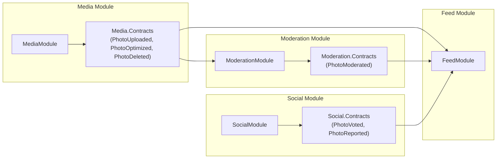
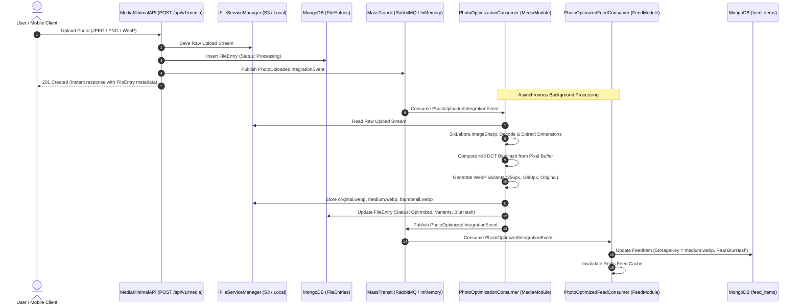
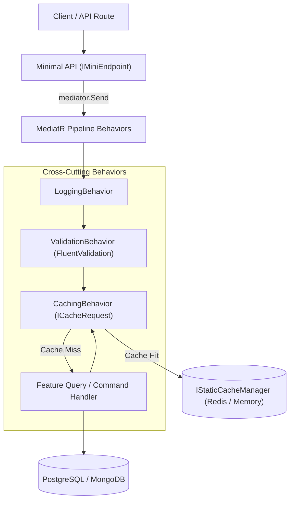

# Vivid Imagination — .NET Modular Monolith Reference Architecture

**Presentation Topic:** *From MVP to Scale: A Modular Monolith Approach to .NET Development*

**Vivid Imagination** is a visual photo-sharing and community application engineered as an enterprise-grade **.NET 10 Modular Monolith**. It demonstrates how to evolve from a fast MVP into a scalable, event-driven, production-ready system with:
- 🤖 **Autonomous AI Moderation via Amazon Rekognition (`AWSSDK.Rekognition`)**
- 🛡️ **Unsafe Tagging & UI Blur Shield (`BlurRequired = true`, `BlurHash`, `SensitiveContentWarning`)**
- 🖼️ **Asynchronous Background WebP Transcoding & Responsive Resizing (Thumbnail: 256px, Medium: 1080px, Original) + Pixel-Accurate 4x3 DCT BlurHash**
- 🗑️ **Cascading Storage Pruning across S3/Local upon Photo Deletion**
- 💾 **Polyglot Persistence (PostgreSQL + MongoDB + Redis)**
- 📨 **Autonomous Modular Messaging (`IMessagingModule` + MassTransit + RabbitMQ)**
- 📦 **Decentralized Module Contracts (`*.Contracts` isolation)**
- ⚡ **Vertical Slice CQRS Minimal APIs (`IMiniEndpoint` + MediatR + FluentValidation)**
- 🚀 **Pipeline Caching & Tag Invalidation (`ICacheRequest`, `IInvalidateCacheRequest`, `IStaticCacheManager`)**
- 📐 **Compile-Time Architecture Boundary Enforcement (`NetArchTest`)**

---

## Documentation Suite

- 📋 **[Product & Software Requirements Specification (SRS)](docs/REQUIREMENTS.md)**
- 🏗️ **[Modular Monolith Scope & Architecture Case Study](docs/ARCHITECTURE_SCOPE.md)**
- 🎤 **[Speaker Deck & Presentation Narrative Guide](docs/PRESENTATION_GUIDE.md)**

---

## Architecture & Module Breakdown

Each business capability is encapsulated into its own autonomous module folder containing an **Implementation Project** and an isolated **Public Contracts Project (`*.Contracts`)**:

| Module | Responsibility | Public Contracts | API Pattern | Storage Engine | Schema / Collection |
| :--- | :--- | :--- | :--- | :--- | :--- |
| **`IdentityModule`** | OAuth2/OIDC authentication, JWT tokens, user safety preferences | `Identity.Contracts` | Minimal API (`MapIdentityApiV1`) | **PostgreSQL** (`EF Core`) | `identity.*` |
| **`MediaModule`** | S3 photo uploads, background WebP transcoding (3 variants), pixel BlurHash, cascading cleanup | `Media.Contracts` | Minimal API (`MapMediaApiV1`) | **MongoDB** (`MongoDB.Driver`) + **AWS S3** | `FileEntries` |
| **`ModerationModule`** | **Amazon Rekognition** AI vision scan, 3-tier safety policy, audit trail, moderator override | `Moderation.Contracts` | Minimal API (`MapModerationApiV1`) | **MongoDB** (`MongoDB.Driver`) | `moderation_reviews` |
| **`SocialModule`** | Upvotes/downvotes, vote cancellation, 2-flag community content reporting | `Social.Contracts` | Minimal API (`MapSocialApiV1`) | **PostgreSQL** (`EF Core`) | `social.*` |
| **`FeedModule`** | Denormalized feed read-models, dynamic score ranking, personalized stream, UI blur flags | `Feed.Contracts` | Minimal API (`MapFeedApiV1`) | **MongoDB** + **Redis** | `feed_items` |

---

## Core Architecture Patterns

### 1. Decentralized Public Contracts (`*.Contracts`)
To prevent the monolithic anti-pattern where all integration events sit inside a shared "dumping ground", each module defines and exports its own public contracts library:
- `VividImagination.Modules.Media.Contracts` &rarr; `PhotoUploadedIntegrationEvent`, `PhotoOptimizedIntegrationEvent`, `PhotoDeletedIntegrationEvent`
- `VividImagination.Modules.Moderation.Contracts` &rarr; `PhotoModeratedIntegrationEvent`
- `VividImagination.Modules.Social.Contracts` &rarr; `PhotoVotedIntegrationEvent`, `PhotoReportedIntegrationEvent`

Consumer modules only reference the specific `.Contracts` package they need, ensuring:
- **No Domain Leakage:** Internal entities, EF contexts, and repositories are completely hidden.
- **Microservice-Ready Extraction:** Extracting any module into a separate microservice requires zero changes to consumer code.



### 2. Autonomous Modular Messaging (`IMessagingModule`)
Rather than registering every consumer centrally in the host's `Program.cs`, modules that consume events implement the `IMessagingModule` interface:
```csharp
public interface IMessagingModule
{
    void RegisterConsumers(IRegistrationConfigurator cfg);
}
```
The host uses `AddModularMassTransit(...)` to automatically discover and wire all module consumers across in-memory or RabbitMQ transports without tight coupling.

### 3. Asynchronous Background Image Optimization Pipeline
Image transcoding and BlurHash calculations are completely decoupled from client uploads:



### 4. Vertical Slice CQRS & Automatic Pipeline Caching
Endpoints are implemented as Minimal APIs (`IMiniEndpoint`) dispatching queries and commands via MediatR. Shared pipeline behaviors handle cross-cutting concerns:
- **`ValidationBehavior`**: Executes FluentValidation validators before handler execution.
- **`CachingBehavior`**: Intercepts requests implementing `ICacheRequest` and evaluates cache hits/misses through `IStaticCacheManager`.
- **`InvalidateCachingBehavior`**: Intercepts commands implementing `IInvalidateCacheRequest` and invalidates cache tags/prefixes (e.g., `"vivid:feed"`).



---

## Solution Structure

```text
vivid-imagination/
├── docs/                                          # Architecture specifications & speaker guides
│   ├── ARCHITECTURE_SCOPE.md
│   ├── PRESENTATION_GUIDE.md
│   └── REQUIREMENTS.md
├── src/
│   └── backend/
│       ├── BuildingBlocks/                        # Reusable infrastructure & shared abstractions
│       │   ├── VividImagination.Shared.Contract/  # Base events (IntegrationEvent, IDomainEvent)
│       │   ├── VividImagination.Shared.Domain/    # Base entities, IAggregate, PagedList
│       │   └── VividImagination.Shared.Infrastructure/ # Caching, Mongo, Messaging, Behaviors
│       ├── Host/
│       │   └── VividImagination.Api/              # ASP.NET Core 10 Host & Composition Root
│       └── Modules/                               # Autonomous Business Modules
│           ├── Identity/                          # User accounts, OAuth/OIDC, Preferences
│           ├── Media/                             # S3 uploads, WebP conversion, BlurHash, Pruning
│           │   ├── VividImagination.Modules.Media/
│           │   └── VividImagination.Modules.Media.Contracts/
│           ├── Moderation/                        # Amazon Rekognition AI scan, 3-tier policy
│           │   ├── VividImagination.Modules.Moderation/
│           │   └── VividImagination.Modules.Moderation.Contracts/
│           ├── Social/                            # Votes, cancellation, 2-flag community reports
│           │   ├── VividImagination.Modules.Social/
│           │   └── VividImagination.Modules.Social.Contracts/
│           └── Feed/                              # Ranked feed read-model, personalized, Redis cache
│               ├── VividImagination.Modules.Feed/
│               └── VividImagination.Modules.Feed.Contracts/
└── tests/
    ├── VividImagination.UnitTests/                # 54 Unit Tests (Feature slices, policies, consumers, WebP)
    └── VividImagination.ArchitectureTests/        # 7 NetArchTest Boundary Enforcement Tests
```

---

## Quick Start

### 1. Prerequisites
- [.NET 10 SDK](https://dotnet.microsoft.com/)
- [Docker & Docker Compose](https://www.docker.com/)

### 2. Start Infrastructure (PostgreSQL, MongoDB, Redis, RabbitMQ)
```bash
docker compose up -d
```

### 3. Run Test Suites
```bash
# Run all Unit Tests (54 passed)
dotnet test tests/VividImagination.UnitTests/VividImagination.UnitTests.csproj

# Run all Architecture Boundary Tests (7 passed)
dotnet test tests/VividImagination.ArchitectureTests/VividImagination.ArchitectureTests.csproj
```

### 4. Run the API Host
```bash
dotnet run --project src/backend/Host/VividImagination.Api
```
The Swagger UI and versioned endpoints will be available at `https://localhost:7001/swagger` (or configured port).
