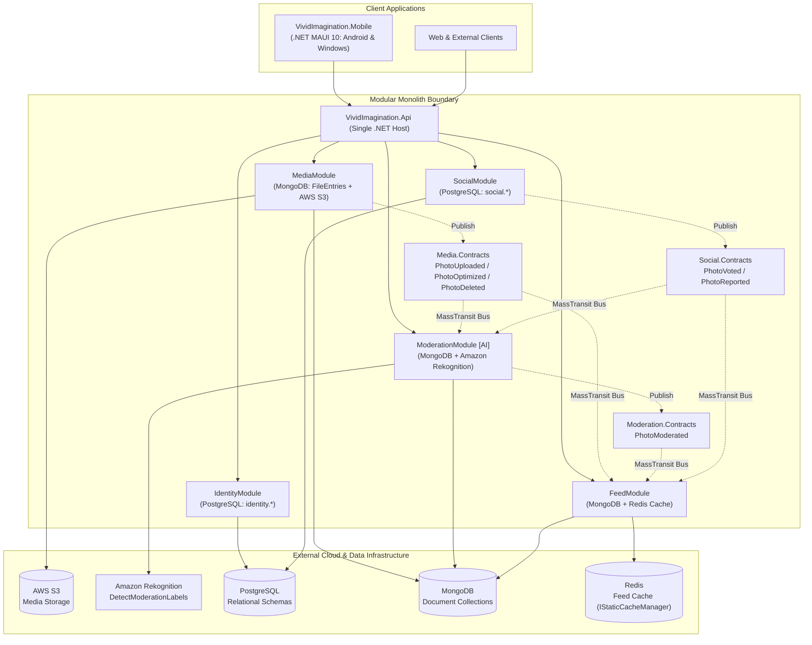

# Vivid Imagination Project Scope: Case Study for ".NET Modular Monolith"

This reference scope document serves as the foundation for the talk: **"From MVP to Scale: A Modular Monolith Approach to .NET Development"**. Using **Vivid Imagination** (a scalable photo-sharing and community platform) as the core case study, this document illustrates how to design strict module boundaries, embrace **polyglot persistence (PostgreSQL + MongoDB)**, orchestrate messaging with **MassTransit / RabbitMQ**, integrate an **AI Content Moderation Module powered by Amazon Rekognition**, and enforce clean architectural separation with **Decentralized Contracts (`*.Contracts`)**, **MediatR CQRS Pipelines**, and **Automated Pipeline Caching**.

---

## 1. Core Functional Requirements (The MVP Phase)

At the MVP stage, the goal is rapid delivery in a single deployable `.NET` host:

*   **User Authentication:** Social sign-in (Google/Facebook/Apple via OIDC) and profile management.
*   **Photo Management:** Upload photos to AWS S3, manage captions/tags, and delete uploads.
*   **Global Photo Feed:** A chronological feed displaying published photos to users.
*   **Community Engagement & Basic Moderation:** 
    *   Users vote (upvote/downvote) on pictures.
    *   **Baseline Community Moderation (The 2-Flag Rule):** Users report inappropriate content; photos receiving 2 or more reports are automatically flagged as `Unsafe` and blurred on the feed.
*   **Client Integration:** Unified Minimal API / REST endpoints serving cross-platform clients (iOS, Android, and Web).

---

## 2. Scaling & Advanced Requirements (The Scale Phase)

As user traffic and media volume scale, the architecture evolves cleanly within its modular boundaries:

*   **Asynchronous Image Processing:** Uploaded images are resized into responsive dimensions (`Thumbnail: 256px`, `Medium: 1080px`, `Original`) in **WebP** format and assigned a pixel-accurate **4x3 DCT BlurHash** placeholder via the `PhotoOptimizationConsumer` background worker, emitting `PhotoOptimizedIntegrationEvent` to update feed projections without blocking HTTP web threads.
*   **Autonomous AI Moderation via Amazon Rekognition:**
    *   **Zero-Copy S3 Vision Inspection:** `ModerationModule` invokes Amazon Rekognition's `DetectModerationLabelsAsync` directly against the S3 bucket & key—inspecting images for NSFW/adult content, suggestive attire, violence, gore, and hate symbols without downloading bytes back into web server memory.
    *   **Three-Tier Policy & UI Blur Shield:**
        *   *Auto-Approved (< 50% risk score):* Published to the global feed with normal visibility (`IsUnsafe = false`, `BlurRequired = false`).
        *   *Tagged Unsafe / Blurred (50% – 84% risk score or Rekognition `"Suggestive"` category):* Remains accessible on the feed (`IsUnsafe = true`, `BlurRequired = true`). Client UIs render a **BlurHash / CSS blur shield** with an explicit **"Show Content"** reveal button.
        *   *Auto-Rejected (≥ 85% risk score in Explicit Nudity / Extreme Violence):* Quarantined immediately and removed from feed projections.
*   **Polyglot Persistence (PostgreSQL + MongoDB):**
    *   **PostgreSQL (`EF Core`):** Powers transactional relational modules (`Identity`, `Social`) using isolated schemas (`identity.*`, `social.*`).
    *   **MongoDB (`MongoDB.Driver`):** Powers document-centric modules (`Media`—storing photo metadata, responsive variant locations, and S3 keys in `FileEntries`—along with `Moderation`—storing variable-length Rekognition label hierarchies—and `Feed`—storing denormalized read-model documents).
*   **Autonomous Distributed Messaging with MassTransit & RabbitMQ:**
    *   Modules implement `IMessagingModule` to register consumers independently, eliminating monolithic central configuration in `Program.cs`.
    *   Switches seamlessly from MassTransit's In-Memory transport (MVP) to **RabbitMQ** exchanges and queues (Scale) with automatic retries and dead-letter queues.
*   **Decentralized Public Contracts (`*.Contracts`):**
    *   Each module exports only its public integration events via an isolated contracts library (e.g., `Media.Contracts`, `Moderation.Contracts`, `Social.Contracts`).
    *   Modules never take direct project references on other module implementations, eliminating domain leakage and circular dependencies.
*   **Vertical Slice CQRS & Pipeline Caching:**
    *   Requests flow through MediatR pipeline behaviors (`LoggingBehavior`, `ValidationBehavior`, `CachingBehavior`, `InvalidateCachingBehavior`).
    *   High-concurrency feed delivery backed by **MongoDB** read models and **Redis** (`IStaticCacheManager`), with smart prefix-based cache invalidation (`vivid:feed`).

---

## 3. Mapping to a .NET Modular Monolith Architecture

### Module & Client Breakdown

| Module / Project | Implementation Project | Contracts Project | Responsibility | Storage Engine | Key Scaling Pattern |
| :--- | :--- | :--- | :--- | :--- | :--- |
| **`IdentityModule`** | `VividImagination.Modules.Identity` | `Identity.Contracts` | OAuth/OIDC sign-in, JWT tokens, user safety preferences, startup role seeding | **PostgreSQL** (`identity.*`) | Snowflake ID role seeding (`IdentityContextSeed`) & `ROLE_NOT_CONFIGURED` fail-fast validation |
| **`MediaModule`** | `VividImagination.Modules.Media` | `Media.Contracts` | S3 uploads, background WebP conversion (3 variants), pixel BlurHash, cascading cleanup | **MongoDB** (`FileEntries`) + **AWS S3** | Unique sparse index on `FileLocation`, compound active index `{ Deleted: 1, UploadedTime: -1 }` |
| **`ModerationModule`** | `VividImagination.Modules.Moderation` | `Moderation.Contracts` | Amazon Rekognition vision scan, unsafe tagging, audit trail, moderator override | **MongoDB** (`moderation_reviews`) | Zero-copy S3 Rekognition scan via `IMessagingModule` consumer |
| **`SocialModule`** | `VividImagination.Modules.Social` | `Social.Contracts` | Upvotes/downvotes, vote cancellation, 2-flag community reports | **PostgreSQL** (`social.*`) | ACID unique composite `(PhotoId, UserId)` constraints |
| **`FeedModule`** | `VividImagination.Modules.Feed` | `Feed.Contracts` | Denormalized feed projections, dynamic ranking, personalized streams, blur directives | **MongoDB** (`feed_items`) + **Redis** | Compound index `{ Score: -1, UploadedAt: -1 }` + CQRS `GetFeedQuery` with `ICacheRequest` prefix invalidation |
| **`MobileClient`** | `VividImagination.Mobile` | N/A (Consumes REST Minimal APIs) | Cross-platform mobile UX (Android, Windows), photo capture/upload, dynamic feed | **Local Cache** | Interactive `BlurShieldView` for sensitive content reveal consent |

---

## 4. Key Takeaways & Story Arcs for Your Talk

1.  **Monolith Deployment, Microservice Autonomy:**
    *   Start with a single `.NET` deployment unit while enforcing compile-time boundaries using `NetArchTest`. All cross-module communication is asynchronous or contract-isolated.
2.  **Decentralized Contracts (`*.Contracts`) as the Clean Boundary Standard:**
    *   Avoid the common anti-pattern of putting all integration events into one monolithic "Shared" assembly. Each module authors its own contract project (`Media.Contracts`, `Social.Contracts`), allowing consumers to reference only what they need.
3.  **Autonomous Messaging via `IMessagingModule`:**
    *   Instead of registering every consumer in the startup file, each module declares its consumers via `IMessagingModule.RegisterConsumers`. The host discovers and configures MassTransit endpoints dynamically.
4.  **Polyglot Persistence Inside One Solution:**
    *   Show the audience that a Modular Monolith does **not** mean "one giant SQL database". `Identity` and `Social` use **PostgreSQL** for relational ACID integrity (e.g., unique vote constraints), while `Media`, `Moderation`, and `Feed` use **MongoDB** for polymorphic media metadata, AI label hierarchies, and pre-aggregated read models.
5.  **Zero-Coupling AI Integration with Amazon Rekognition & MassTransit:**
    *   `MediaModule` only publishes `PhotoUploadedIntegrationEvent`. `ModerationModule` consumes it via **MassTransit / RabbitMQ**, calls **Amazon Rekognition**, and emits `PhotoModeratedIntegrationEvent` with `IsUnsafe = true` and `BlurRequired = true`.
6.  **Pipeline Caching with MediatR Behaviors:**
    *   Keep Minimal API endpoints extremely thin. Pipeline behaviors automatically intercept queries implementing `ICacheRequest` and commands implementing `IInvalidateCacheRequest`, delegating storage and prefix invalidation to `IStaticCacheManager`.
7.  **Nuanced UX Over Binary Censorship:**
    *   Demonstrate how domain policy translates Rekognition's `"Suggestive"` or moderate-risk scores into **UI Blur Shields (`BlurRequired = true`)** with user-consent reveal toggles rather than binary allow/delete.
8.  **Effortless Extraction in Minutes:**
    *   Because `ModerationModule` communicates exclusively via `.Contracts` events and owns its **MongoDB** collection, extracting it into an independent microservice or serverless worker requires zero changes to domain, application, or consumer code.
9.  **Cross-Platform Client Experience (.NET MAUI 10):**
    *   Show how a client application directly honors backend moderation directives. The `BlurShieldView` control demonstrates that safety is not just a database boolean, but an end-to-end user experience that balances safety with user agency.
10. **Modern Multi-Job CI/CD & Automated Boundary Enforcement:**
    *   Showcase how 74 unit tests, 7 NetArchTest architectural boundary rules, and a containerized build-and-deploy pipeline ensure production stability on every commit, while a dedicated Android job builds release APK/AAB packages without polluting backend CI environments.
